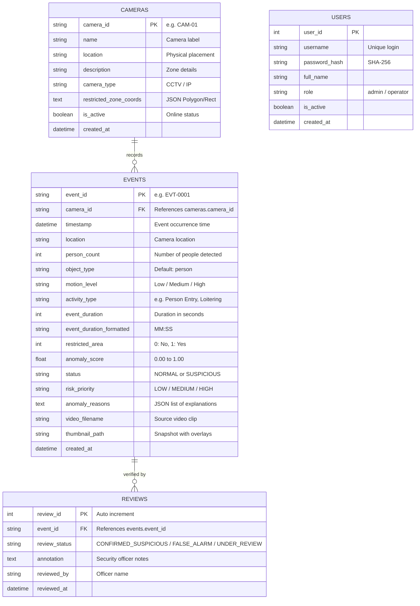

# Database Schema & Entity-Relationship Documentation

## Overview
The database layer manages camera configurations, automatically generated event metadata, and human operator reviews. It supports SQLite (default zero-configuration file `data/surveillance_events.db`) and MySQL / PostgreSQL via `DATABASE_URL`.

---

## Entity Relationship (ER) Diagram

---

## Table Definitions

### 1. `cameras`
| Column | Type | Constraints | Description |
|---|---|---|---|
| `camera_id` | VARCHAR(50) | PRIMARY KEY | Unique camera code (CAM-01, CAM-02, etc.) |
| `name` | VARCHAR(100) | NOT NULL | Human-readable camera name |
| `location` | VARCHAR(150) | NOT NULL | Building zone / floor / gate |
| `description` | VARCHAR(255) | NULL | Camera purpose description |
| `camera_type` | VARCHAR(50) | DEFAULT 'CCTV' | Feed type |
| `restricted_zone_coords` | TEXT | NULL | JSON array of normalized polygon vertices |
| `is_active` | BOOLEAN | DEFAULT TRUE | Active feed status |
| `created_at` | DATETIME | DEFAULT UTC_NOW | Registration timestamp |

### 2. `events`
| Column | Type | Constraints | Description |
|---|---|---|---|
| `event_id` | VARCHAR(50) | PRIMARY KEY | Unique identifier (EVT-0001) |
| `camera_id` | VARCHAR(50) | FOREIGN KEY -> cameras | Originating camera |
| `timestamp` | DATETIME | NOT NULL, INDEX | Recorded incident time |
| `location` | VARCHAR(150) | NOT NULL | Camera location snapshot |
| `person_count` | INTEGER | NOT NULL | Peak concurrent/unique count |
| `object_type` | VARCHAR(50) | DEFAULT 'person' | Detected entity class |
| `motion_level` | VARCHAR(50) | NOT NULL | 'Low', 'Medium', 'High' |
| `activity_type` | VARCHAR(100) | NOT NULL | Behavioral categorization |
| `event_duration` | INTEGER | NOT NULL | Dwell duration in seconds |
| `event_duration_formatted` | VARCHAR(50) | NOT NULL | Formatted (MM:SS) |
| `restricted_area` | INTEGER | DEFAULT 0 | 1 if zone incursion occurred |
| `anomaly_score` | FLOAT | NOT NULL | ML Anomaly Score (0.0 to 1.0) |
| `status` | VARCHAR(50) | NOT NULL | 'NORMAL' or 'SUSPICIOUS' |
| `risk_priority` | VARCHAR(50) | NOT NULL | 'LOW', 'MEDIUM', 'HIGH' |
| `anomaly_reasons` | TEXT | NULL | Plain-language diagnostic reasons |
| `video_filename` | VARCHAR(255) | NULL | Source video file |
| `thumbnail_path` | VARCHAR(255) | NULL | Keyframe image path |
| `created_at` | DATETIME | DEFAULT UTC_NOW | Processing timestamp |

### 3. `reviews`
| Column | Type | Constraints | Description |
|---|---|---|---|
| `review_id` | INTEGER | PRIMARY KEY, AUTO_INCREMENT | Unique review entry |
| `event_id` | VARCHAR(50) | FOREIGN KEY -> events | Reviewed event |
| `review_status` | VARCHAR(50) | NOT NULL | Review verdict |
| `annotation` | TEXT | NULL | Security officer comments |
| `reviewed_by` | VARCHAR(100) | NOT NULL | Officer username / name |
| `reviewed_at` | DATETIME | DEFAULT UTC_NOW | Review timestamp |
